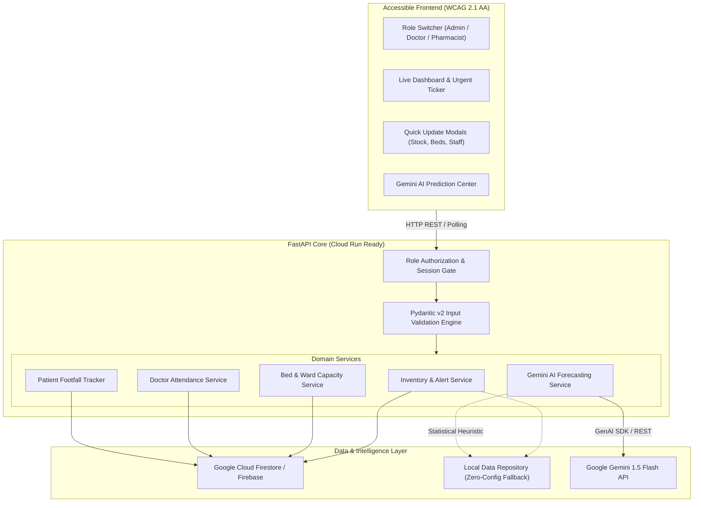

# Smart Health 🏥

**Real-Time Facility Management & AI Forecasting System for Primary Health Centres (PHCs) & Community Health Centres (CHCs)**

[](https://www.python.org/)
[](https://fastapi.tiangolo.com/)
[](tests/)
[](https://cloud.google.com/run)
[](https://www.w3.org/WAI/standards-guidelines/wcag/)

---

## 🌟 Overview

**Smart Health** is an operations intelligence and resource management platform engineered specifically for public healthcare facilities (PHCs and CHCs). It bridges critical data gaps in rural and semi-urban health centres by offering:

- 📊 **Real-Time Live Dashboard & 7-Day Visual Influx Chart**: Stat cards, occupancy progress bars, and an accessible SVG daily footfall breakdown updating with zero page reloads.
- ⚡ **Interactive Epidemic Surge Simulation**: One-click demo injection of a monsoon gastroenteritis/viral outbreak to watch real-time stockout alerts, emergency bed saturation (100%), and AI predictions react dynamically.
- 📥 **One-Click District Drug Indent Export (CSV)**: Instant generation of an official National Health Mission (NHM) drug requisition sheet calculating buffer replenishment quantities.
- 🚨 **Automated Alerting Engine**: Instant alerts for out-of-stock life-saving drugs, low-stock warnings, expiring batches, bed capacity saturation (> 90%), and doctor coverage shortages.
- ✨ **AI Demand & Footfall Forecasting (Google Gemini API)**: Multi-factor predictive modeling analyzing current patient footfall velocity, seasonal disease burdens (e.g. monsoon vector outbreaks, dehydration spikes), and clinic schedules to forecast medicine stock-out horizons and patient congestion windows.
- 👥 **Role-Based Access Control (RBAC)**: Dedicated views and permissions for **Admin (MOIC)**, **Doctor (Medical Officer)**, and **Pharmacist (Dispensary)**.
- 📝 **Simple Resource Modals**: Accessible quick-action forms to update medicine stock (dispense / restock), bed occupancy per ward, doctor attendance, and patient arrivals.
- ♿ **Accessible UI (WCAG 2.1 AA)**: Semantic HTML5, high-contrast palette (contrast ratio ≥ 4.5:1), ARIA live regions, focus-visible indicators, and full keyboard navigation.
- ☁️ **Cloud Native & Firestore Ready**: Native support for **Google Cloud Firestore** and **Google Cloud Run** containerization, with an automatic zero-configuration local fallback for immediate evaluation.

---

## 🏗️ Architecture



---

## 👥 Role-Based Access Control (RBAC) Matrix

| Action / Capability | Admin (MOIC) | Doctor | Pharmacist |
| :--- | :---: | :---: | :---: |
| View Live Dashboard & Alerts | ✅ | ✅ | ✅ |
| View Medicine Stock & Search | ✅ | ✅ | ✅ |
| Dispense / Restock Medicine | ✅ | ❌ | ✅ |
| Add New Medicine Item | ✅ | ❌ | ✅ |
| Delete Medicine Record | ✅ | ❌ | ❌ |
| View Bed Availability Matrix | ✅ | ✅ | ✅ |
| Update Ward Beds (Occupied/Cleaning) | ✅ | ✅ | ❌ |
| Check-in / Check-out Attendance | ✅ | ✅ | ❌ |
| Add New Doctor to Roster | ✅ | ❌ | ❌ |
| Log Patient Footfall Arrival | ✅ | ✅ | ✅ |
| Generate Gemini Medicine Demand Forecast | ✅ | ❌ | ✅ |
| Generate Gemini Patient Footfall Forecast | ✅ | ✅ | ❌ |

---

## ⚡ Quick Start (Local Development)

### 1. Prerequisites
- Python 3.11+ (Python 3.13 recommended)
- Git

### 2. Installation
```powershell
# Clone the repository
git clone https://github.com/your-username/smart-health-app.git
cd smart-health-app

# Create virtual environment (optional)
python -m venv venv
venv\Scripts\activate   # Windows
# source venv/bin/activate # Linux/macOS

# Install dependencies
pip install -r requirements.txt -r requirements-dev.txt
```

### 3. Environment Setup
Copy `.env.example` to `.env`:
```powershell
cp .env.example .env
```
Key configuration parameters:
```env
# Optional: Enter your Gemini API Key for live multimodal forecasts
# If left blank, the built-in statistical heuristic engine engages seamlessly
GEMINI_API_KEY=your_gemini_api_key_here

# Optional: Enter your Firebase Project ID for Cloud Firestore
# If left blank, the thread-safe local data repository engages automatically
FIREBASE_PROJECT_ID=

# Server Port (default 8080)
PORT=8080
```

### 4. Run the Application
```powershell
python -m uvicorn app.main:app --reload --port 8080
```
Open your browser and navigate to:
👉 **`http://localhost:8080`**

---

## 🧪 Running Unit & Integration Tests

Smart Health includes an automated test suite verifying data validation, role boundaries, alert triggers, and AI response extraction:

```powershell
python -m pytest -v --tb=short
```

Test coverage includes:
- `tests/test_api_endpoints.py`: Full CRUD integration for medicines, beds, doctors, and footfall.
- `tests/test_validation.py`: Pydantic v2 input validation (over-dispensing prevention, bed capacity bounds, negative number rejections, date formatting).
- `tests/test_roles.py`: Role authorization enforcement (403 Forbidden checks).
- `tests/test_alerts.py`: Low-stock, stock-out, high bed occupancy, and zero-doctor alerts.
- `tests/test_ai_forecasting.py`: Gemini markdown fence JSON extraction, schema validation, and heuristic fallback logic.

---

## 🚀 Google Cloud Run Deployment

Smart Health is fully containerized and production-ready for Google Cloud Run.

### Option 1: One-Command Build & Deploy via gcloud
```powershell
# Authenticate with Google Cloud
gcloud auth login
gcloud config set project YOUR_GCP_PROJECT_ID

# Deploy directly from source to Cloud Run
gcloud run deploy smart-health \
    --source . \
    --platform managed \
    --region us-central1 \
    --allow-unauthenticated \
    --set-env-vars="GEMINI_API_KEY=your_key,FIREBASE_PROJECT_ID=your_project"
```

### Option 2: Docker Build & Run Locally
```powershell
# Build Docker image
docker build -t smart-health:1.0.0 .

# Run container locally
docker run -p 8080:8080 -e PORT=8080 smart-health:1.0.0
```

### Cloud Run Features
- **Dynamic Port Binding**: Honors `$PORT` environment variable injected by Google Cloud Run.
- **Health Probes**: Liveness probe configured on `/healthz` and readiness on `/readyz`.
- **Security**: Runs as unprivileged `appuser` (non-root).

---

## ♿ Accessibility (WCAG 2.1 AA) Compliance

Smart Health was developed with accessibility at its core:
1. **Color Contrast**: All typography and UI components strictly exceed the 4.5:1 contrast requirement (e.g. text `#0f172a` against white `#ffffff` is 16:1).
2. **Keyboard Navigation**:
   - Skip to main content link (`#main-content`).
   - High-contrast visual focus rings (`*:focus-visible { outline: 3px solid #0284c7; outline-offset: 2px; }`).
   - Accessible modal focus trapping with `Escape` key close handlers.
3. **Screen Reader Support**:
   - Semantic HTML5 structure (`<header role="banner">`, `<nav role="navigation">`, `<main id="main-content">`).
   - Dynamic ARIA live region (`aria-live="polite"`) announcing live alerts, role switches, and operational changes.
   - Descriptive `aria-label` and `aria-describedby` attributes on interactive elements.

---

## 📄 License
MIT License. Built for public healthcare innovation.
